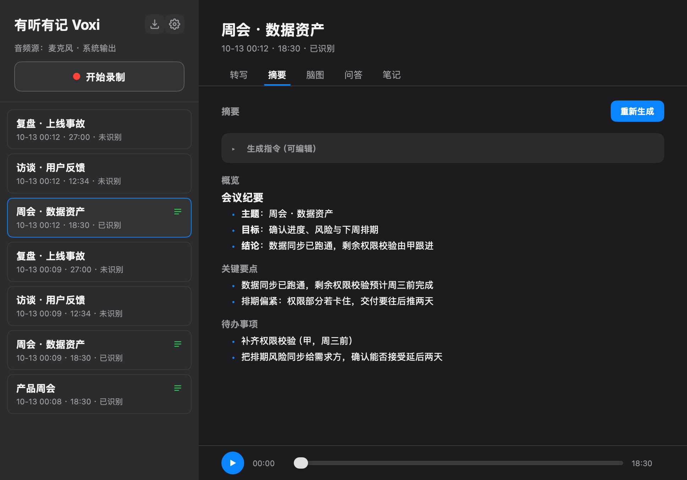

# 有听有记 Voxi

一个 macOS 会议助手，用 [`mygo`](https://github.com/egoist/mygo) 的 `ui` 包绘制原生界面：录制会议音频，把录音管理成一个资料库，调用语音识别把它转写成带时间线的文字，再在转写之上生成摘要、脑图、问答和笔记。



## 前置准备

录音、播放、笔记都不依赖外部服务，但**转写**和**摘要 / 脑图 / 问答**需要你先备好三样东西：

### 1. 语音识别：豆包语音的 API Key

转写走火山引擎「豆包语音」的录音文件识别（`volc.seedasr.auc`，即豆包录音文件识别模型 2.0）。

1. 打开[豆包语音控制台](https://console.volcengine.com/speech/new/experience/asr)，开通「录音文件识别」；
2. 在控制台创建一个 **API Key**；
3. 把它填进本应用设置里的「语音识别（豆包语音）」→ API Key。

只要一个 API Key 就够了，**不需要** App ID 或 Access Token。调用产生的费用与额度由你的火山账号决定。

### 2. cloudflared

豆包这个接口只接受**公网 URL**，不能直接上传文件。所以识别时本应用会先在 `127.0.0.1` 上起一个只绑本机、路径带随机 token 的临时 HTTP 服务，再用 `cloudflared` 的 quick tunnel 把它临时映射到公网，供火山服务器拉取音频，识别结束立刻关闭。

```sh
brew install cloudflared
```

装在别处也没关系：GUI 应用不继承终端的 `$PATH`，程序默认按 `/opt/homebrew/bin/cloudflared` 等常见位置查找，找不到时可以在设置里手动填可执行文件路径。

> **隐私提示**：识别期间，这条录音会短暂地出现在一个不可猜测的公网地址上，并被火山服务器下载。隐私敏感的录音请自行斟酌。

### 3. 一个大模型接入点（LLM）

摘要、脑图、问答需要一个 **OpenAI 兼容**的 `chat/completions` 接入点。设置里可以保存多个供应商，用顶部的「使用模型」下拉在「供应商 / 模型」之间切换；每个供应商填这几样：

| 项        | 说明                                                                                                                      |
| -------- | ----------------------------------------------------------------------------------------------------------------------- |
| Base URL | 填接入点的根地址即可（如 `https://api.deepseek.com`）。程序会先去掉结尾的 `/`，再补上 `/chat/completions`；如果你填的已经是完整的 `.../chat/completions`，则原样使用 |
| API Key  | 该服务的密钥                                                                                                                  |
| 模型    | 如 `deepseek-chat`、`gpt-4o-mini` 等；一个供应商可填多个，用逗号分隔，每个都会出现在「使用模型」下拉里。也可点「获取模型列表」从接口的 `/models` 拉取后点选 |

**要不要带 `/v1` 取决于服务商**，本应用不做猜测：DeepSeek 的 `https://api.deepseek.com` 和 `https://api.deepseek.com/v1` 都可用（`/v1` 只是它提供的 OpenAI 兼容路径，两者都指向同一套接口）；而 OpenAI 的路径必须带版本段，得填 `https://api.openai.com/v1`。填完点「验证连接」实测一下，返回 404 基本就是路径少写或多写了 `/v1`。

任何 OpenAI 兼容服务都可以：OpenAI、DeepSeek、火山方舟、本地跑 Ollama / LM Studio 等。填好后可以点「验证连接」发一个最小请求实测。**不配也能用**——录音、播放、笔记、转写都不受影响，只是摘要 / 脑图 / 问答会不可用。

## 构建与运行

先装一次 mygo 的命令行工具，之后就可以直接用 `mygo`：

```sh
go install github.com/egoist/mygo/cmd/mygo@v0.3.5   # 装一次即可
mygo build .                                        # 打包成 .app 和 .dmg
mygo dev .                                          # 开发：热重载
```

`go install` 会把 `mygo` 放进 `$(go env GOPATH)/bin`（通常是 `~/go/bin`），如果提示 `command not found`，把这个目录加进 `$PATH`，或者直接用下面 `go run` 的写法——不装也能跑，只是每次都要重新解析一遍模块：

```sh
go run ./cmd/voxi                                       # 开发：直接跑
go run github.com/egoist/mygo/cmd/mygo@v0.3.5 build .   # 打包成 .app 和 .dmg
go run github.com/egoist/mygo/cmd/mygo@v0.3.5 dev .     # 开发：热重载
```

需要 Go 1.27+。mygo 是普通 Go module 依赖，由 `go.mod` 拉取，**不需要克隆 mygo 仓库**。

### 打包成 .dmg

在 macOS 上，`mygo build` **会顺带生成 dmg**，不用额外命令：

```sh
mygo build .
```

产物落在 `mygo.json` 里 `out` 指定的目录（本项目是 `build/`）下的平台子目录中：

```
build/darwin-arm64/
  有听有记Voxi.app          12.7 MB
  有听有记Voxi 0.2.0.dmg     3.8 MB     # 名字是「应用名 版本号.dmg」，版本号取自 mygo.json
```

dmg 用系统自带的 `hdiutil` 生成，打开后是一个把应用拖进 `Applications` 的窗口（Finder 布局由生成好的 `.DS_Store` 决定）。相关开关：

- 不想要 dmg：加 `-skip-dmg`；
- 想要通用二进制：`-platform darwin/universal`；
- dmg 只能在 macOS 上生成，在别的系统上构建会提示跳过。

## 安装与首次运行（未签名）

本项目**没有 Apple Developer ID 签名**，mygo 默认只做 ad-hoc 签名（`codesign` 的 `flags=0x2(adhoc)`，`TeamIdentifier=not set`），因此 Gatekeeper 会拒绝它：

```sh
$ spctl -a -vvv "build/darwin-arm64/有听有记Voxi.app"
build/darwin-arm64/有听有记Voxi.app: rejected
```

从 dmg 或网络下载来的副本还会被系统打上隔离标记（`com.apple.quarantine`），双击时提示「已损坏，无法打开」或「无法验证开发者」。**去掉隔离标记即可正常运行**：

```sh
xattr -dr com.apple.quarantine /Applications/有听有记Voxi.app
```

`-d` 是删除指定扩展属性，`-r` 是递归到包内所有文件。如果你是对挂载中的 dmg 里的 app 操作，把路径换成 `/Volumes/.../有听有记Voxi.app`，**注意要在拖进 `Applications` 之后再执行一次**，因为复制到新位置会保留隔离标记。

也可以走图形界面：在「系统设置 → 隐私与安全性」底部点「仍要打开」，但每个版本都要点一次，命令行更省事。

> 自己构建、直接从 `build/` 目录运行的话，本地产物通常不带隔离标记，可以直接打开。

## 系统权限

应用需要以下权限，都是 macOS 的 TCC 隐私授权，**首次触发时系统会弹窗**，也可以在「系统设置 → 隐私与安全性」里手动开关：

| 权限       | 什么时候需要                        | 授予方式                                           |
| -------- | ----------------------------- | ---------------------------------------------- |
| **屏幕录制** | **首次点「录制」时就会请求，即使只勾了麦克风**（见下） | 系统设置 → 隐私与安全性 → 屏幕录制 → 勾选「有听有记Voxi」，**然后重启应用** |
| **麦克风**  | 勾选了「麦克风」音频源时                  | 系统设置 → 隐私与安全性 → 麦克风 → 勾选「有听有记Voxi」             |
| **本地网络** | 一般不需要                         | 临时文件服务只绑 `127.0.0.1`，回环流量不算本地网络；若系统仍弹出请求，允许即可  |

**为什么只录麦克风也要屏幕录制权限？** 音频捕获走 ScreenCaptureKit，而它的 API 模型是「先拿到屏幕内容（`SCShareableContent`）→ 用它构造内容过滤器 → 在过滤器上开流并勾选音频」。所以代码在建立捕获流之前必须拿到显示器列表，这一步就会触发屏幕录制授权，与你要不要系统声音无关。被拒绝时的报错是「无法访问屏幕内容（需要"屏幕录制"权限）」。

**授予屏幕录制权限后必须重启应用**，这是 macOS 的要求，当前进程内不会生效。

**重新构建后可能要重新授权。** 因为只做 ad-hoc 签名，系统的授权记录绑在具体签名（cdhash）上，每次重新构建都会产生新的签名，系统可能把它当成另一个程序。遇到「明明授权过了却还是失败」时，去系统设置里把旧条目删掉（选中后按 `-`），再重新授权一次。

**排障**：设置环境变量 `VOXI_DEBUG=1` 启动，音频捕获的详细日志（每个源是否正常出帧、格式、失败原因）会追加写入 `~/voxi-debug.log`。

## 目录结构

```
cmd/voxi/         程序入口
internal/app/     界面与状态：录音库、播放器，以及录制 / 转写 / 摘要 / 脑图 / 问答 / 笔记
internal/md/      摘要的 Markdown 解析与绘制（块级 / 行内 / 表格）
internal/audio/   音频捕获、AAC 编码与播放（macOS 部分走 ScreenCaptureKit + purego，无需 cgo）
internal/store/   录音库的 JSON 索引与数据模型
internal/asr/     火山引擎「豆包语音」录音文件识别
internal/llm/     OpenAI 兼容的大模型调用（摘要 / 脑图 / 问答 / 连接验证）
internal/tunnel/  cloudflared quick tunnel，供 ASR 从公网取音频
```

`internal/` 下的包不被外部导入；界面代码集中在 `internal/app`，因为它需要访问应用状态的私有字段。

## 录制

左侧边栏顶部有「录制」按钮，下面一行小字显示当前要捕获的音频源；音频源——麦克风，以及系统输出（扬声器或耳机正在播放的声音）——改在右上角齿轮打开的设置里勾选。点击录制开始捕获所选音频源，点击停止结束。录制中可以「暂停」/「继续」：暂停期间的声音不会写进文件，恢复后接着录在同一个文件里，计时和保存的时长都不含暂停的时间；暂停中也可以直接「停止并保存」。暂停时采集流并不关闭（只是丢弃数据），所以恢复是即时的，但系统菜单栏的录制指示会一直亮着。
侧栏的计时、保存到库里的时长都按**实际写进文件的音频**算，而不是按开始到停止的时间。系统有时会在不给应用任何通知的情况下停掉采集流（实测：磁盘空间紧张时 macOS 的清理服务通知 ScreenCaptureKit 停掉所有采集，录音在启动约 5 分钟后只剩空白），所以录制中只要超过 5 秒没有音频写入，就判定采集已中断，自动重启采集并向文件里补上这段时长的静音，侧栏同时提示。自动恢复失败时会显示「录制失败」和原因，已经录下的部分仍可停止并保存。开始录制时若磁盘剩余低于 15 GB，侧栏会提示系统清理可能中断录音。所选音频源会被混合成一个 AAC（`.m4a`）文件，并通过 `ExtAudioFile`（AudioToolbox，经 purego 驱动——无需 cgo）边录边编码，而不是全部堆在内存里，因此无论录多久内存占用都保持平稳。输出为 48 kHz 立体声、128 kbps，体积只有未压缩 WAV 的一小部分。

音频捕获使用 ScreenCaptureKit，仅支持 macOS；混入麦克风需要 macOS 15 及以上。在其他平台上窗口依然会打开，并说明无法捕获。

该应用会录制麦克风和系统音频，因此它的应用包声明了 `NSMicrophoneUsageDescription` 和 `NSAudioCaptureUsageDescription`（见 `mygo.json`）。macOS 只会把这些权限授予 `Info.plist` 中带有相应用途说明的应用包，所以录制功能需在 `mygo build` 产出的 `.app` 中才能工作——裸 `go run` 出来的二进制不行，系统会在它访问麦克风时将其终止。请用 `mygo build`（或 `dev`）来测试录制。

## 设置

点侧边栏右上角的齿轮打开设置弹窗，顶部用页签分「通用」（外观、录制）、「语音识别」「大模型」三页：

- **外观**：浅色、深色，或跟随系统（默认）。改完立即生效，弹窗背后就是效果。
- **录制**：勾选要捕获的音频源（麦克风、系统输出），以及录音文件的存放位置（默认是下载目录）。改到别的目录时可以选择把已有录音一起搬过去；不搬的话旧录音留在原处，仍可播放和识别。
- **语音识别（豆包语音）**：填写 [豆包语音](https://console.volcengine.com/speech/new/experience/asr) 的 API Key 与 cloudflared 可执行文件路径（默认 `/opt/homebrew/bin/cloudflared`），用于录音转写。
- **大模型（LLM）**：保存多个 OpenAI 兼容的供应商（名称、Base URL、API Key、模型列表），用「使用模型」下拉选定一个「供应商 / 模型」驱动摘要 / 脑图 / 问答；删掉正在用的供应商会自动改用列表里第一个模型；模型不止一个时，摘要 / 脑图 / 问答页的生成或发送按钮旁也有同一个下拉可直接切换；Base URL 输入框下方会实时显示最终请求的完整地址（省得猜 `/v1` 该不该写），每个供应商可单独点「验证连接」，用它的第一个模型向该地址发一个最小请求实测是否可用。供应商平时收起成一行（名称、模型数、域名、验证结果），点一下展开编辑，同一时间只展开一个；「获取模型列表」拉回的模型也默认收起在「从接口选择」下。

设置持久化在应用数据目录的 `settings.json`。注意：ASR 与 LLM 的 API Key 以**明文**保存在该文件里，界面上也直接明文显示（文件仅当前用户可读）；如果在意，别在会被备份 / 同步或共享的机器上填入敏感密钥。

窗口的大小、位置和最大化状态记在应用数据目录的 `window-state.json`（由 mygo 维护），下次打开时恢复。若原来那块屏幕已经不在了，窗口会回到主屏并夹到工作区大小，不会跑到看不见的地方。

弹窗底部显示当前版本（取自 `mygo.json` 的 `version`）；裸 `go run` 出来的构建不带版本号，那里显示 `版本 dev`。每个版本改了什么见 [`CHANGELOG.md`](CHANGELOG.md)。

## 管理与识别

左侧是录音库，右侧是选中录音的详情。详情页从上到下是标题、分页签，底部是一条常驻的播放器（播放键、可拖动的进度条、已播 / 总时长），页签内容在它上方滚动：

- **转写**：调用豆包语音把录音识别成带时间戳的分段文字；点时间戳跳转播放、点文字就地编辑（自动保存）、点说话人改名（可选「仅此条」或「全部相同」）；顶部「重新识别」可重跑（会覆盖当前转写）。录音文件原样（`.m4a`）提交，不做转码。识别过程中转写页逐步显示：本地文件服务 → 建立临时隧道（只显示域名）→ 隧道可达（第几次探测）→ 提交到豆包语音（任务 ID 可复制）→ 等待识别结果（排队中 / 处理中、已查询次数、火山已下载的音频字节）→ 解析结果，每步带用时；侧栏和标题下的状态也显示当前步骤。火山不提供识别百分比，所以没有进度条。失败时步骤列表留在页面上，标出失败的那一步和原因。每次识别的步骤与用时都追加写入应用数据目录的 `asr.log`（超过 1 MB 重新开始），不含隧道的完整地址。
- **摘要**：把转写发给大模型，默认按「脏数据清洗 + 结构化会议纪要」的指令生成一份正式纪要（含行动项表格、议题分歧、会议金句），生成指令（prompt）可编辑。指令要求返回 overview / highlights / actions 的 JSON 时，结果分「概览 / 关键要点 / 待办事项」三块显示；其他格式（如默认的 Markdown 纪要）整篇按 Markdown 渲染。
- **脑图**：把转写整理成可展开/折叠的大纲树。
- **问答**：基于转写内容多轮提问，回答流式逐字返回并按 Markdown 渲染（列表、表格、代码块）。生成中可「停止生成」，已收到的部分保留；回答下可「复制」原文、对最后一条「重新生成」，每一问一答可单独删除。顶部工具栏：「新话题」插入一条分隔线，之前的问答仍在屏幕上但不再发给模型；「归档」把当前对话存进「历史会话」并开始空白对话，历史会话可展开查看、恢复为当前对话（当前对话非空时会先被归档）或删除；「清空」确认后删除当前对话。出错的回答不会作为上下文再发给模型。输入框 Enter 发送、Shift+Enter 换行，输入框为空时按 ↑ 调出上一个问题。输入框上方是一排预设问题（超过 5 个收进「更多」），对话为空时以卡片形式列出；点一下只是填进输入框，可修改后再发。预设是全局的，直接在问答页管理：右键预设选「编辑」「删除」，点按钮行末尾的「+」（或空对话里的「+ 添加预设」）新增。
- **笔记**：每条录音一段自由文本，自动保存。

录音库、转写、摘要、脑图、问答和笔记都持久化在应用数据目录的 `recordings.json` 里；重新识别后，已生成的摘要和脑图会被标记为「可能过期」，提示重新生成。
